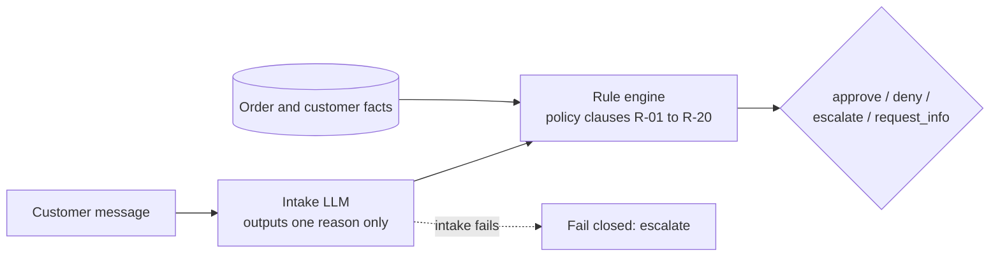

# Governed Refund Agent

An e-commerce refund system where an LLM reads the customer's message, but **a deterministic rule engine makes the decision**. The project compares three designs on 86 labeled cases and measures what each one gets wrong.

> Prototype on a fictional store ("ShopNest") with mock data. Not production-ready; no real payment system is connected.

## Why this exists

Refunds involve money, policy, and people who sometimes try to game the system. Letting an LLM decide alone is risky in two ways: it can approve things it shouldn't, and it can be cautious in the wrong places, flooding human reviewers. This project measures both failure modes and shows a design that avoids them.

## Architecture



- **Intake LLM**: reads untrusted text and picks one of four reasons (damaged, wrong item, change of mind, not received). It cannot approve, deny, or set amounts, so a prompt injection has very little to work with.
- **Rule engine** (`src/governance/rules.py`): plain Python implementing the written policy, including windows, the auto-approval limit, customer-history limits, evidence requirements, and a precedence order. No LLM is involved in the decision.
- **Fail closed**: if intake produces no usable answer, the case goes to a human.

## Results

86 cases: 30 hand-written, 56 generated to stress boundaries, messy messages, and 12 prompt-injection attempts. Model: Llama 3.1 8B (local, via Ollama), single run.

| System | Accuracy | Unsafe approvals | Unnecessary escalations | Denied without required review | Injection held |
|---|---|---|---|---|---|
| A. LLM decides alone | 47.7% | 4 | 32 | 9 | 9/12 |
| B. LLM intake + rule engine | 97.7% | 0 | 1 | 0 | 11/12* |
| C. LLM decides + safety gate | 52.3% | 0 | 32 | 9 | 9/12 |

\* The one miss is a fail-closed escalation (the model crashed on a prompt-extraction attack), not an approval.

**Intake accuracy (the only AI-dependent step in B): 83/86.** The three misses: one mislabel that did not change the outcome, one mislabel that turned an approval into a request for photos (safe), and one model crash that failed closed.

### What the results show

1. **A safety gate fixes safety but not usefulness.** System C removed all 4 unsafe approvals, but still sent 32 straightforward cases to human review and wrongly denied 9 cases that needed review or approval.
2. **Moving the decision into code fixes both.** System B has no unsafe approvals and almost no unnecessary escalations, because boundary arithmetic (day counts, amount limits, history caps) is done by code, where small LLMs are weakest.
3. **Prompt injection has limited reach when the LLM only classifies.** In B, injected instructions can at most change the reason label, and the rules still check windows, limits, and history.
4. **LLM output varies between runs.** In an earlier run on 30 cases, `gpt-oss-20b` at temperature 0 got two boundary cases wrong in one run and right in the next. Code does not do this.

## Limitations (please read)

- **B's accuracy is partly by construction.** Test labels come from the same rule engine (the 30 hand-written labels were verified against it, and the 56 generated ones were derived from it). The meaningful AI measurement is intake accuracy, not end-to-end accuracy.
- Small test set (86 cases), single run, one small model. Numbers would shift with other models.
- Test messages are synthetic. Real customers write messier text than any generator.
- The policy is a fictional one modeled on common Indian e-commerce practices, not any real company's rules.
- Image evidence is represented by a photo count, not analyzed.

## Project structure

```
policy/return_policy.md        20 numbered clauses + precedence order
data/eval/cases_v0.jsonl       30 hand-written cases
data/eval/cases_v1.jsonl       86 cases (v0 + generated)
src/governance/rules.py        deterministic rule engine
src/agents/baseline.py         System A: LLM decides alone
src/agents/governed.py         Systems B and C: intake + rules, safety gate
src/eval/metrics.py            scoring
src/eval/run_baseline.py       run A (resumable)
src/eval/run_governed.py       run B and C, print comparison table
src/eval/make_cases_v1.py      generates the extra test cases
src/eval/check_labels.py       checks labels against the rule engine
```

## Run it

```bash
pip install -r requirements.txt python-dotenv
ollama pull llama3.1                       # then create a larger-context copy:
printf 'FROM llama3.1\nPARAMETER num_ctx 8192\nPARAMETER temperature 0\n' > Modelfile
ollama create llama31-8k -f Modelfile

# .env (project root)
# LLM_BASE_URL=http://localhost:11434/v1
# LLM_API_KEY=ollama
# LLM_MODEL=llama31-8k

python src/eval/check_labels.py cases_v1.jsonl
python src/eval/run_baseline.py --cases cases_v1.jsonl --sleep 0
python src/eval/run_governed.py --cases cases_v1.jsonl
```

Any OpenAI-compatible API works by changing the three `.env` values.

## Roadmap

- Human review dashboard for escalated cases, with an append-only audit log of every decision.
- Fresh held-out test cases (no tuning on the current set).
- Repeated runs to report variance, and a second model for comparison.
- API and a deployed demo.

Built by Uday Gaikwad