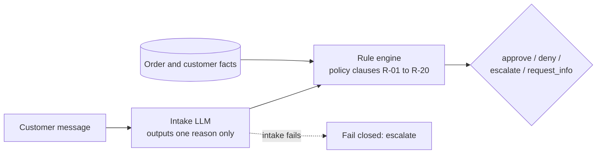

# Governed Refund Agent

**Live demo:** _add your Streamlit link here after deploying_

An e-commerce refund system where an LLM reads the customer's message, but **a deterministic rule engine makes the decision**. The project compares three designs on 86 labeled cases and measures what each one gets wrong.

> Prototype on a fictional store ("ShopNest") with mock data. Not production-ready; no real payment system is connected.

## Why this exists

Refunds involve money, policy, and people who sometimes try to game the system. Letting an LLM decide alone is risky in two ways: it can approve things it shouldn't, and it can be cautious in the wrong places, flooding human reviewers. This project measures both failure modes and shows a design that avoids them.

## Architecture



- **Intake LLM**: reads untrusted text and picks one of four reasons (damaged, wrong item, change of mind, not received). It cannot approve, deny, or set amounts, so a prompt injection has very little to work with.
- **Rule engine** (`src/governance/rules.py`): plain Python implementing the written policy, including windows, the auto-approval limit, customer-history limits, evidence requirements, and a precedence order. No LLM is involved in the decision.
- **Fail closed**: if intake produces no usable answer, the case goes to a human.

## Results

86 cases: 30 hand-written, 56 generated to stress boundaries, messy messages, and 12 prompt-injection attempts. Model: Llama 3.1 8B (local, via Ollama), single run.

| System | Accuracy | Unsafe approvals | Unnecessary escalations | Denied without required review | Injection held |
|---|---|---|---|---|---|
| A. LLM decides alone | 47.7% | 4 | 32 | 9 | 9/12 |
| B. LLM intake + rule engine | 97.7% | 0 | 1 | 0 | 11/12* |
| C. LLM decides + safety gate | 52.3% | 0 | 32 | 9 | 9/12 |

\* The one miss is a fail-closed escalation (the model crashed on a prompt-extraction attack), not an approval.

**Intake accuracy (the only AI-dependent step in B): 83/86.** The three misses: one mislabel that did not change the outcome, one mislabel that turned an approval into a request for photos (safe), and one model crash that failed closed.

### What the results show

1. **A safety gate fixes safety but not usefulness.** System C removed all 4 unsafe approvals, but still sent 32 straightforward cases to human review and wrongly denied 9 cases that needed review or approval.
2. **Moving the decision into code fixes both.** System B has no unsafe approvals and almost no unnecessary escalations, because boundary arithmetic (day counts, amount limits, history caps) is done by code, where small LLMs are weakest.
3. **Prompt injection has limited reach when the LLM only classifies.** In B, injected instructions can at most change the reason label, and the rules still check windows, limits, and history.
4. **LLM output varies between runs.** In an earlier run on 30 cases, `gpt-oss-20b` at temperature 0 got two boundary cases wrong in one run and right in the next. Code does not do this.

## Held-out check

After the first 86 cases, I wrote 40 new cases (`cases_v2.jsonl`, ids H01-H40) with hand-written, varied phrasing and ran them once. The intake prompt and `rules.py` were not changed between the two runs. I wrote these after seeing the v1 results, so they are held out from tuning but not blind.

| System | Accuracy | Unsafe approvals | Unnecessary escalations | Denied without required review | Wrong amounts | Injection held |
|---|---|---|---|---|---|---|
| A. LLM decides alone | 35.0% | 2 | 17 | 6 | 1 | 2/5 |
| B. LLM intake + rule engine | 100% | 0 | 0 | 0 | 0 | 5/5 |
| C. LLM decides + safety gate | 42.5% | 0 | 17 | 6 | 0 | 2/5 |

Intake accuracy on the new phrasing: **38/40** (v1: 83/86). Both misses were harmless: one case was decided earlier in the rule precedence (window check), and the other had no matching order. That is a property of this particular set, not a guarantee.

**Combined, 126 cases:**

| System | Accuracy | Unsafe approvals | Unnecessary escalations | Denied without required review | Injection held |
|---|---|---|---|---|---|
| A. LLM decides alone | 43.7% | 6 | 49 | 15 | 11/17 |
| B. LLM intake + rule engine | 98.4% | 0 | 1 | 0 | 16/17* |
| C. LLM decides + safety gate | 49.2% | 0 | 49 | 15 | 11/17 |

Intake accuracy overall: 121/126 (96.0%; roughly 91-98% as a 95% interval, given the small sample). \* The one miss is a fail-closed escalation.

## Limitations (please read)

- **B's accuracy is partly by construction.** Test labels come from the same rule engine (the 30 hand-written labels were verified against it, and the 56 generated ones were derived from it). The meaningful AI measurement is intake accuracy, not end-to-end accuracy.
- Small test sets (86 + 40 cases), one run each, one small model. Numbers would shift with other models.
- Test messages are synthetic. Real customers write messier text than any generator.
- The policy is a fictional one modeled on common Indian e-commerce practices, not any real company's rules.
- Image evidence is represented by a photo count, not analyzed.

## Project structure

```
policy/return_policy.md        20 numbered clauses + precedence order
data/eval/cases_v0.jsonl       30 hand-written cases
data/eval/cases_v1.jsonl       86 cases (v0 + generated)
data/eval/cases_v2.jsonl       40 held-out cases with hand-written messages
src/governance/rules.py        deterministic rule engine
src/agents/baseline.py         System A: LLM decides alone
src/agents/governed.py         Systems B and C: intake + rules, safety gate
src/eval/metrics.py            scoring
src/eval/run_baseline.py       run A (resumable)
src/eval/run_governed.py       run B and C, print comparison table
src/eval/make_cases_v1.py      generates the extra v1 test cases
src/eval/make_cases_v2.py      generates the held-out v2 cases
src/eval/check_labels.py       checks labels against the rule engine
src/webapp/streamlit_app.py    demo: submit requests, human review queue, audit log
src/webapp/pipeline.py         one request through intake -> rules -> kill switch
src/webapp/audit.py            tamper-evident (hash-chained) audit log
requirements.txt               dashboard and evaluation dependencies
requirements-api.txt           adds FastAPI, uvicorn, httpx, pytest
src/api/main.py                FastAPI app: endpoints, auth
src/api/service.py             one request end to end, human review
src/api/adapters.py            OrderStore / RefundGateway interfaces + mocks
src/api/db.py                  SQLite storage + hash-chained audit table
data/mock/                     mock orders and customers
tests/test_api.py              20 API tests
```

## Run it

```bash
pip install -r requirements.txt
ollama pull llama3.1                       # then create a larger-context copy:
printf 'FROM llama3.1\nPARAMETER num_ctx 8192\nPARAMETER temperature 0\n' > Modelfile
ollama create llama31-8k -f Modelfile

# .env (project root)
# LLM_BASE_URL=http://localhost:11434/v1
# LLM_API_KEY=ollama
# LLM_MODEL=llama31-8k

python src/eval/check_labels.py cases_v1.jsonl
python src/eval/run_baseline.py --cases cases_v1.jsonl --sleep 0
python src/eval/run_governed.py --cases cases_v1.jsonl
```

Any OpenAI-compatible API works by changing the three `.env` values.

## Dashboard

```bash
pip install -r requirements.txt
streamlit run src/webapp/streamlit_app.py
```

- **New request**: type a message and order details (or load any of the 86 test cases), and see the decision with the policy clauses cited.
- **Review queue**: escalated cases wait for a human, who approves (capped at what the customer paid) or rejects with a note.
- **Audit log**: every decision and human review is appended to a hash-chained log. Editing an old entry breaks the chain, and the page detects it. (Tamper-evident, not tamper-proof.)
- **Kill switch** (sidebar): turns off automatic approvals, so every would-be approval goes to a human.
- Each browser session gets its own log and review queue, stored in a temporary file (set `PERSISTENT_LOG=1` to use the shared file `data/runtime/audit_log.jsonl` instead when running locally).
- Intake can use the LLM (offered only when `LLM_MODEL` and `LLM_API_KEY` are set), a simple keyword matcher (so the demo runs without any model), or a manually chosen reason. The keyword matcher is much weaker than the LLM and exists only for demos.

<!-- Add a screenshot here:  -->

### Deploying the demo (Streamlit Community Cloud)

1. Push the repo to GitHub (the root `requirements.txt` holds only what the dashboard needs).
2. At share.streamlit.io, sign in with GitHub and choose **New app**.
3. Select the repo, branch `main`, and main file path `src/webapp/streamlit_app.py`.
4. Deploy. Do **not** add an LLM key to a public demo: without `LLM_MODEL` and `LLM_API_KEY` the app offers keyword and manual intake only, which is what a public visitor should get.

Community Cloud's file system is temporary, which is why the dashboard keeps each visitor's log in a per-session temp file.

## API and adapter layer

```bash
pip install -r requirements-api.txt
uvicorn api.main:app --app-dir src --reload      # docs at http://127.0.0.1:8000/docs
pytest -q tests                                   # 20 tests
```

Set `API_KEY` in `.env` (default `dev-key` for local use) and send it as the `X-API-Key` header. `INTAKE_MODE=keyword` (default) needs no model; `INTAKE_MODE=llm` uses the Ollama or OpenAI-compatible settings from `.env`.

| Endpoint | Purpose |
|---|---|
| `POST /refund-requests` | Submit `{order_id, customer_id, message, photos}`. Returns the decision, clauses, and a customer-facing message. |
| `GET /refund-requests/{id}` | Look up a request and its decision details. |
| `GET /reviews/pending` | Escalated cases waiting for a human. |
| `POST /reviews/{id}` | Human approves (capped at what is left of the payment) or rejects. |
| `GET/POST /admin/kill-switch` | Turn automatic approvals off or on. |
| `GET /audit`, `GET /audit/verify` | Recent audit entries and the hash-chain integrity check. |

```bash
curl -X POST localhost:8000/refund-requests -H "X-API-Key: dev-key" -H "Content-Type: application/json" \
  -d '{"order_id":"O-1001","customer_id":"C-01","message":"The vase arrived broken, photo attached.","photos":1}'
```

**Facts never come from the customer.** The request carries only an order id, a customer id, a message, and a photo count. Price, category, delivery date, tracking status, account flags, and refund history are looked up from the store and from this system's own records.

**Controls beyond the written policy:** a duplicate-refund guard (a second approval on the same order goes to a human), the kill switch, fail-closed intake, idempotency keys on every refund, and a payment-side check that refuses to refund more than was captured.

### Connecting a real store

The system touches the outside world through two interfaces in `src/api/adapters.py`:

- `OrderStore`: `get_order(order_id)` and `is_flagged(customer_id)`. A real version would call the store's order API (Shopify, WooCommerce, or an in-house system) and map the response to the fields the rule engine needs.
- `RefundGateway`: `issue_refund(order_id, amount, idempotency_key)`. A real version would call the payment provider's refund API (Razorpay, Stripe, or the store's own), passing the idempotency key so retries cannot refund twice.

Intake, the rule engine, the audit log, and the review queue do not change. The included mocks (`MockOrderStore`, `MockRefundGateway`) are for development and tests. I have not built or tested any real integration, and each provider's current API documentation and permissions would need to be checked.

**Not production-ready:** one shared API key (no per-user login), reviewer names are self-reported, SQLite instead of a production database, no rate limiting, and no image analysis. A real rollout would start in shadow mode, with humans still deciding while the system's suggestions are compared against theirs.

## Roadmap

- Repeated runs to report variance, and a second model for comparison.
- Public deployed demo (the keyword intake mode runs without a model).
- Docker packaging and a real database.
